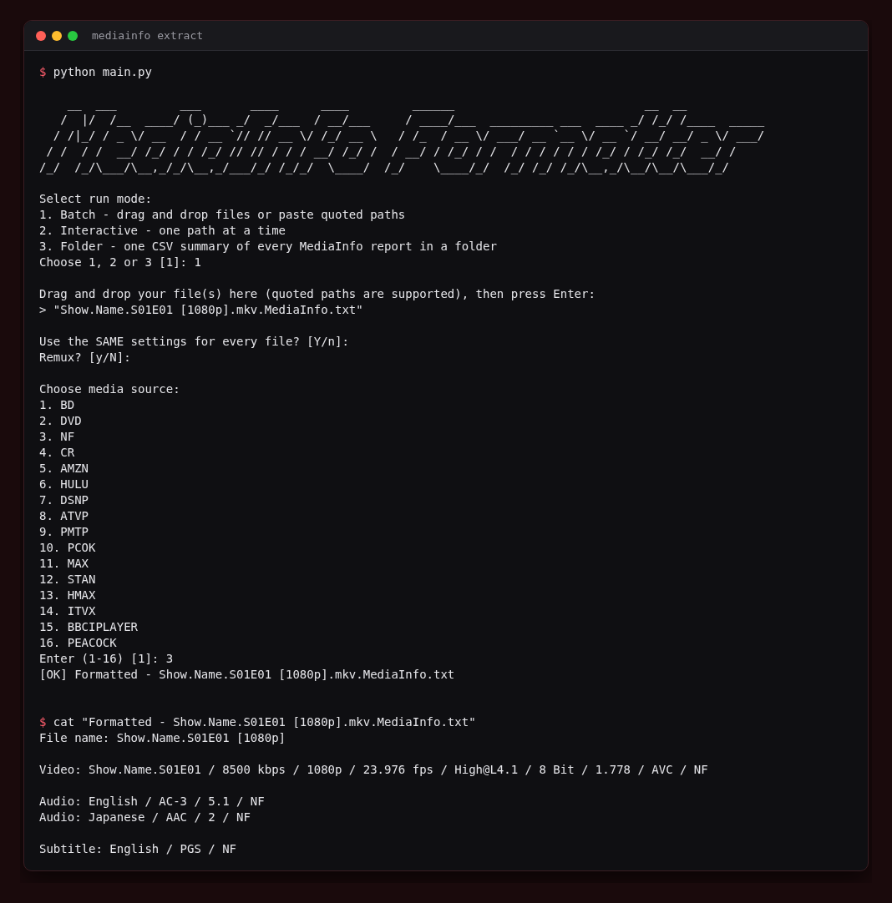

<div align="center">

# MediaInfoExtraction

**A Python CLI tool that parses MediaInfo advanced text exports and formats the key encoding details into a clean, ready-to-use output file.**

[](https://www.python.org/)
[](LICENSE)

</div>



---

Reads a `.MediaInfo.txt` file exported from MediaInfo (Advanced mode) and extracts the key technical properties from the Video, Audio, and Text (subtitle) tracks. The formatted output is written as `Formatted - <original filename>.txt` next to the input file and is ready for use in encoding notes or release tagging.

Two run modes are available: batch mode for processing multiple files in one go, and interactive mode for one file at a time.

---

## What It Extracts

### Video track

- Bit rate (normalised to kbps or Mbps)
- Frame rate (e.g. `23.976 fps`)
- Format profile (e.g. `High@L4.1`)
- HDR format: `HDR10`, `HDR10+`, and/or `Dolby Vision` (all three can appear together)
- Bit depth (e.g. `10 Bit`)
- Display aspect ratio (normalised to decimal, e.g. `1.778`)
- Video codec (e.g. `HEVC`, `AVC`, `MPEG Video`)

### Audio tracks (one entry per track)

- Language
- Codec: `AC-3`, `E-AC-3`, `E-AC-3 JOC` (Atmos), `DTS`, `DTS XLL`, `DTS XLL X` (DTS:X), `MLP FBA`, `MLP FBA 16-ch` (TrueHD Atmos), `FLAC`, `AAC`, `OPUS`, `VORBIS`, `MP3`, `MP2`
- Channels: `2`, `5.1`, or `7.1`
- Sampling rate
- Bit rate (uses Maximum bit rate for 5.1/7.1 tracks)

### Subtitle tracks (one entry per track)

- Language
- Format (e.g. `ASS`, `UTF-8` remapped to `ASS`, `PGS`)

### Quality detection

- Quality is read from bracket tags in the filename (e.g. `[1080p]`, `[2160p]`, `[4K]`)
- Falls back to resolution detection from Width/Height lines if no bracket tag is found

---

## Output Format

```
File name: Show.Name.S01E01 [1080p] [HDR10]

Video: Show.Name.S01E01 / 8500 kbps / 1080p / 23.976 fps / High@L4.1 / HDR10 / 10 Bit / 1.778 / HEVC / NF

Audio: English / E-AC-3 JOC / 5.1 / 48.0 kHz / 768 kbps / NF
Audio: English / AC-3 / 2 / 48.0 kHz / 192 kbps / NF

Subtitle: English / ASS / NF
Subtitle: French / PGS / NF
```

`[Remux]` is appended to the filename if you choose Yes when prompted.

---

## Usage

```bash
python main.py
```

### Batch mode (default)

Drag and drop one or more files onto the terminal prompt (quoted paths are supported via `shlex`). You can apply the same settings to every file or configure each one individually.

### Interactive mode

Enter one file path at a time. The tool asks after each file whether to process another.

### Folder to CSV

Choose mode 3, or skip the menu entirely:

```bash
python main.py --csv "/media/Shows/Show Name"
python main.py --csv "/media/Shows" -o shows.csv
```

Every MediaInfo text report in the folder and its subfolders becomes one row of `mediainfo-summary.csv`. The columns are file, name, quality, video format, bit rate, frame rate, profile, HDR, Dolby Vision, bit depth, aspect ratio, audio track count, audio summary and subtitle languages. Other `.txt` files (including `Formatted - ...` outputs) are ignored.

### Tests

```bash
pip install pytest
python -m pytest tests
```

---

## Media Source Tags

The source tag appended to each line (e.g. `NF`, `AMZN`, `BD`) is chosen from a numbered menu at runtime.

Built-in sources:

```
BD  DVD  NF  CR  AMZN  HULU  DSNP  ATVP  PMTP  PCOK  MAX  STAN
HMAX  ITVX  BBCIPLAYER  PEACOCK
```

To use a custom list, create `sources.txt` next to `main.py` with one source per line. The script loads from that file automatically and falls back to the built-in list if the file is missing or empty.

---

## Requirements

- Python 3.8+
- No third-party dependencies (stdlib only)
- A `.MediaInfo.txt` export from MediaInfo with **Advanced mode** enabled

To enable Advanced mode in MediaInfo: View -> Advanced mode (or press `Ctrl+7`).

---

---

## Install as a command (pipx)

Install this folder as a CLI so it is available on your PATH:

```bash
pipx install .
mediainfo-extract
```


## Get the Code

Clone with git:

```bash
git clone https://github.com/drew-codes-things/MediaInfoExtract.git
```

Or with the [GitHub CLI](https://cli.github.com/):

```bash
gh repo clone drew-codes-things/MediaInfoExtract
```

## License

MIT - made by [Drew](https://github.com/drew-codes-things)
